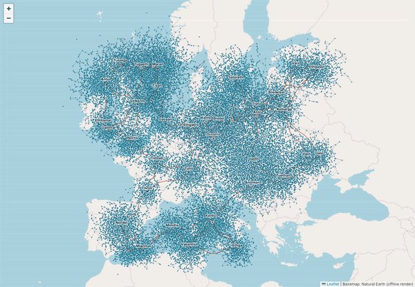

# skeinmap

[](https://github.com/GNP50/skeinmap/stargazers)

skeinmap draws very large node–link graphs — hundreds of thousands to about a million nodes
and edges — on a single canvas, over a Leaflet or MapLibre GL map or in a plain pan/zoom view,
with picking, hover outlines, tooltips and decluttered labels. A graph is a handful of typed
arrays and a table of up to 32 styles; drawing uses WebGL2 (with a Canvas 2D fallback), and the
loops that grow with the graph run in WebAssembly once it has loaded, with a pure TypeScript
implementation that gives the same output before that or if it never loads.



_The [live demo](https://gnp50.github.io/skeinmap/demo/) over Leaflet at the 1M setting: 347,224 nodes and 649,239 edges
(1,063,518 instances). Basemap drawn from Natural Earth data._

**[Live demo](https://gnp50.github.io/skeinmap/demo/)** ·
[Documentation](https://gnp50.github.io/skeinmap/) · [Getting started](docs/guide/getting-started.md) ·
API reference: `npm run docs:api` builds it into `docs/api/`

## Features

- **One canvas for the whole graph.** Nodes are discs, edges are lines or polylines, drawn by
  one layer instead of one map or DOM object per element.
- **WebGL2 with a Canvas 2D fallback.** On WebGL2 the scene lives on the GPU and a pan or zoom
  updates a few uniforms. Positions use split float32 (double-single) precision, so they stay
  sub-pixel at street zoom. If the context is lost, the layer continues on Canvas 2D.
- **Level of detail** on WebGL2 for large scenes: a per-zoom reduction that looks the same at
  that zoom, computed asynchronously and optionally in a Web Worker.
- **Restyle is a byte write.** Every element carries a style byte. A selection or a theme switch
  rewrites bytes or the table, never geometry.
- **Picking without a scan.** Hover and click query a grid in absolute pixels that survives
  panning. Tooltips (text, or escaped HTML with a ready-made card), a hover outline, `onHover`.
- **Labels** placed greedily by priority on an occupancy grid, so dense views stay readable.
- **Filters** hide nodes or edges with a byte mask (`setFilter`), without rebuilding the scene.
- **Per-element colours and sizes** (`nodeColor`, `nodeRadius`, `edgeColor`, `edgeWidth`) on top
  of the style table, and **arrowheads** for directed edges.
- **Selection** in a box or a lasso (`queryBox`, `queryPolygon`); the standalone view has
  shift-drag box selection and keyboard navigation built in.
- **Clustering** per zoom (`createClusterIndex`): grid clusters with counts, member lists and
  merged edges, as a scene you swap in.
- **Interop and edge shapes**: GeoJSON import/export, graphology import, curved and parallel
  edges, great-circle arcs.
- **World copies** on Mercator maps, with picking and labels on every copy.
- **Optional WebAssembly.** Mercator projection, level-of-detail binning, grid builds,
  Douglas–Peucker simplification and clustering run in Rust/WebAssembly when loaded and in TypeScript
  otherwise. Loading is asynchronous and nothing waits for it.
- **Adapters** for Leaflet 1.9 and MapLibre GL, a dependency-free pan/zoom view, and a
  four-member contract for anything else. React bindings included; Vue, Svelte and others use
  the core directly.
- **Strict-CSP friendly.** No `eval`; WebAssembly needs only `'wasm-unsafe-eval'` and falls
  back cleanly without it.
- ESM and CommonJS builds with type declarations, safe to import during server-side
  rendering.

## Install

skeinmap is installed from this Git repository: npm clones it, builds it (the `prepare`
script) and installs the result. Pin a commit or a tag so every install builds the same
code:

```sh
npm install github:GNP50/skeinmap#<commit-or-tag>
# and, if you use them:
npm install leaflet          # skeinmap/leaflet
npm install maplibre-gl      # skeinmap/maplibre
npm install react            # skeinmap/react
```

which records it in `package.json` as

```json
"dependencies": {
  "skeinmap": "github:GNP50/skeinmap#<commit-or-tag>"
}
```

`package-lock.json` stores the exact commit, so `npm ci` reinstalls the same build. To move
to a newer version, change the commit or tag and run `npm install` again.

### What the install needs

The build compiles the WebAssembly kernels, so the machine (or Docker stage) that runs
`npm install` / `npm ci` needs, besides Node.js 22+ and git:

- **Rust stable** with the WebAssembly target: `rustup target add wasm32-unknown-unknown`
- **wasm-bindgen-cli 0.2.100**, exactly the version the crate pins:
  `cargo install wasm-bindgen-cli --version 0.2.100 --locked`

`wasm-opt` comes from the `binaryen` dev dependency, which npm installs for the build on its
own. Without the Rust tools the install fails with a message naming the missing one. Only
the install needs them: the installed package is plain JavaScript plus a `.wasm` file.

A Docker build stage with the toolchain (Alpine, as used by `node:*-alpine`):

```dockerfile
FROM node:22-alpine AS deps
RUN apk add --no-cache git curl build-base
ENV RUSTUP_HOME=/usr/local/rustup CARGO_HOME=/usr/local/cargo PATH=/usr/local/cargo/bin:$PATH
RUN curl -sSf https://sh.rustup.rs | sh -s -- -y --profile minimal --default-toolchain stable \
      --target wasm32-unknown-unknown \
 && cargo install wasm-bindgen-cli --version 0.2.100 --locked \
 && rm -rf /usr/local/cargo/registry
WORKDIR /app
COPY package.json package-lock.json ./
RUN npm ci
```

The runtime image does not need any of it: copy the built application (or `node_modules`)
from that stage.

## Quickstart

Every example uses this scene and style table. On a map, `x` is longitude and `y` is latitude
(GeoJSON order).

```ts
import { SceneBuilder, type SceneStyles } from 'skeinmap'

const b = new SceneBuilder()
const a = b.node(2.35, 48.86, 0)
const c = b.node(13.4, 52.52, 1)
const d = b.node(12.5, 41.9, 0)
b.edge(a, c, 0)
b.edge(c, d, 0, [13.4, 52.52, 15.0, 47.0, 12.5, 41.9]) // a polyline
const scene = b.build()

const styles: SceneStyles = {
  nodes: [
    { radius: 4, fill: '#0e7490' },
    { radius: 7, fill: '#c2410c', stroke: '#fff', strokeWidth: 1.5 },
  ],
  edges: [{ color: '#64748b', width: 1.5 }],
}
```

### Standalone (no map)

```ts
import { createGraphLayer, createPanZoomAdapter, initWasm, sceneBounds } from 'skeinmap'
import 'skeinmap/style.css'

void initWasm() // optional, not awaited

const adapter = createPanZoomAdapter(document.getElementById('graph')!) // x/y are world units
const layer = createGraphLayer(adapter, {
  scene,
  styles,
  nodeTooltip: (i) => `Node ${i}`,
  onNodeClick: (i) => console.log('clicked', i),
})
adapter.fitBounds(sceneBounds(scene)!)
```

### Leaflet

```ts
import L from 'leaflet'
import 'leaflet/dist/leaflet.css'
import { addGraphLayer, fitScene } from 'skeinmap/leaflet'

const map = L.map('map')
L.tileLayer('https://tile.openstreetmap.org/{z}/{x}/{y}.png', {
  attribution: '&copy; OpenStreetMap contributors',
}).addTo(map)

const layer = addGraphLayer(L, map, { scene, styles })
fitScene(L, map, scene)
```

`createLeafletLayer(L, options)` returns a real `L.Layer` for layer controls.

### MapLibre GL

```ts
import * as maplibregl from 'maplibre-gl'
import 'maplibre-gl/dist/maplibre-gl.css'
import { addGraphLayer, fitScene } from 'skeinmap/maplibre'

const map = new maplibregl.Map({ container: 'map', style: 'https://demotiles.maplibre.org/style.json', maxPitch: 0 })
const layer = addGraphLayer(map, { scene, styles })
fitScene(map, scene)
```

### React

```tsx
import type { MapAdapter } from 'skeinmap'
import { GraphCanvas, useGraphLayer } from 'skeinmap/react'

// The standalone view, sized by its style or class.
export function Graph() {
  return <GraphCanvas scene={scene} styles={styles} style={{ height: 600 }} onNodeClick={(i) => select(i)} />
}

// Any adapter, for example leafletAdapter(L, map) for a map created in an effect.
export function GraphOnMap({ adapter }: { adapter: MapAdapter | null }) {
  const layerRef = useGraphLayer(adapter, scene, { styles, nodeTooltip: (i) => names[i] })
  return null // the layer draws into the map's container
}
```

Inline callbacks are fine: they are read through a ref. A new `scene` object re-projects.

### Vue

```ts
// <div ref="host" style="height: 600px" />
onMounted(() => {
  adapter = createPanZoomAdapter(host.value!)
  layer = createGraphLayer(adapter, { scene: props.scene, styles })
})
watch(
  () => props.scene,
  (s) => layer?.setScene(s),
)
onBeforeUnmount(() => {
  layer?.destroy()
  adapter?.dispose()
})
```

### Svelte

```ts
// <div bind:this={host} style="height: 600px"></div>
onMount(() => {
  adapter = createPanZoomAdapter(host)
  layer = createGraphLayer(adapter, { scene, styles })
})
onDestroy(() => {
  layer?.destroy()
  adapter?.dispose()
})
```

Full versions of every snippet are in [Getting started](docs/guide/getting-started.md).

### Selecting and restyling

```ts
scene.nodeStyle[i] = 2 // an index into styles.nodes
layer.restyle() // no geometry is rebuilt
```

### Filters

```ts
const visible = Uint8Array.from(degree, (d) => (d >= 3 ? 1 : 0)) // 1 visible, 0 hidden
layer.setFilter({ nodes: visible }) // edges touching a hidden node are hidden too
layer.setFilter(null)
```

Hidden elements are not drawn, picked, labelled or queried; your scene's style bytes are left
alone. Writing the style byte `HIDDEN` (255) and calling `restyle()` does the same from the data.
See [Filters](docs/concepts/filters.md).

### Per-element colours, sizes and arrows

```ts
import { rgba, packColor } from 'skeinmap'

scene.nodeColor = Uint32Array.from(degree, (d) => (d > 5 ? rgba(239, 68, 68) : 0)) // 0 = style's fill
scene.nodeRadius = Float32Array.from(weight, (w) => 2 + w) // 0 = style's radius
scene.edgeColor = new Uint32Array(scene.edgeCount).fill(packColor('#475569'))
layer.restyle()

const styles = { nodes: [{ radius: 4, fill: '#0e7490' }], edges: [{ color: '#64748b', width: 1.5, arrow: 9 }] }
```

`arrow` is the arrowhead length in pixels at each edge's `to` end. See
[Styles](docs/concepts/styles.md#per-element-colours-and-sizes).

### Selection

```ts
const adapter = createPanZoomAdapter(element, {
  onBoxSelect: ({ x0, y0, x1, y1 }) => highlight(layer.queryBox(x0, y0, x1, y1)), // shift-drag
  onReset: () => fit(), // the 0 key; arrows pan, +/- zoom
})
const lassoed = layer.queryPolygon(points) // container pixels
```

Both return the indices of visible nodes whose centre is inside. A lasso over a map is a few
pointer listeners: see [Selection](docs/concepts/selection.md).

### Clustering

```ts
import { createClusterIndex } from 'skeinmap'

const index = createClusterIndex(scene) // longitude/latitude, 60 px cells
const { scene: clusters, counts, members } = index.level(Math.floor(Math.log2(adapter.getViewport().k)))
layer.setScene(clusters) // swap again when the integer zoom changes
```

Each level is computed once (WebAssembly or TypeScript, same clusters) and cached. See
[Clustering](docs/concepts/clustering.md).

### GeoJSON, graphology and edge shapes

```ts
import {
  greatCirclePath,
  curvedPath,
  parallelCurvature,
  sceneFromGeoJSON,
  sceneFromGraph,
  sceneToGeoJSON,
} from 'skeinmap'

const { scene, nodeFeature } = sceneFromGeoJSON(collection, { snap: 1e-6 }) // points → nodes, lines → edges
const fromGraph = sceneFromGraph(graph, { x: 'lon', y: 'lat' }).scene // a graphology graph
const geojson = sceneToGeoJSON(scene)

b.edge(a, c, 0, greatCirclePath(-0.13, 51.51, 103.82, 1.35)) // great-circle arc
for (let i = 0; i < 3; i++) b.edge(a, c, 0, curvedPath(ax, ay, cx, cy, parallelCurvature(i, 3))) // parallel edges
```

See [GeoJSON, graphs and edge shapes](docs/guide/interop.md).

### World copies

```ts
createGraphLayer(adapter, { scene, styles, worldCopies: true }) // Mercator adapters
```

The scene is drawn again on every copy of the world in view, with picking, tooltips, labels and
queries on each. See [Adapters](docs/concepts/adapters.md#world-copies).

## WebAssembly

The WebAssembly module is optional. Call `initWasm()` once, early, without awaiting it: layers
start on the TypeScript kernels and switch automatically when the module is ready. If it cannot
load — an old browser, a Content Security Policy without `'wasm-unsafe-eval'`, a bundler that
did not emit the file — `initWasm()` resolves `false` and everything keeps working on
TypeScript, with the same output.

```ts
import { initWasm, wasmStatus, setKernelPreference } from 'skeinmap'

void initWasm() // or initWasm(url | Response | bytes | WebAssembly.Module)
wasmStatus() // 'idle' | 'loading' | 'ready' | 'failed'
setKernelPreference('ts') // force TypeScript (benchmarks, debugging)
```

Content Security Policy: WebAssembly needs `script-src 'wasm-unsafe-eval'` (never
`'unsafe-eval'`); the optional level-of-detail worker needs `worker-src`. With
`tooltipHtml: true`, escape every value with `escapeHtml` or use `tooltipCard`. See
[WebAssembly kernels](docs/concepts/wasm.md) and [Content Security Policy](docs/guide/csp.md).

## Bundlers

- **Vite**: add `optimizeDeps: { exclude: ['skeinmap'] }`, otherwise pre-bundling separates
  the module from its `.wasm` in development and `initWasm()` falls back to TypeScript.
  Production builds work as is.
- **webpack 5, Next.js, Parcel**: the `.wasm` is found with `new URL(..., import.meta.url)` and
  emitted as an asset automatically. In Next.js, create the layer in a client component.
- **CommonJS / Node**: the CommonJS build reads the `.wasm` from disk under Node. Elsewhere, pass
  the URL or the bytes to `initWasm()`.
- **SSR**: every entry is safe to import on the server; `createGraphLayer` needs a DOM, so call
  it from an effect or mount hook.

Details, including the level-of-detail worker: [Bundlers and frameworks](docs/guide/frameworks.md).

## How it compares

skeinmap does one thing: a large, flat node–link graph with interaction, on a map or on its
own. Other libraries are better choices for other jobs.

| Library                                                           | Choose it when                                                                                                                                                        | Compared with skeinmap                                                                                                                                                                                                                                                                                                                                            |
| ----------------------------------------------------------------- | --------------------------------------------------------------------------------------------------------------------------------------------------------------------- | ----------------------------------------------------------------------------------------------------------------------------------------------------------------------------------------------------------------------------------------------------------------------------------------------------------------------------------------------------------------- |
| [deck.gl](https://deck.gl)                                        | You need many layer types (heatmaps, hexagons, arcs, 3D extrusions, point clouds), 3D or pitched views, or GPU data filtering and transitions.                        | A far broader and more mature framework, with GPU-side data filtering and many extensions. skeinmap is much smaller and specialised to nodes and edges: edges by node index, label decluttering, tooltips, box and lasso selection, node clustering with merged edges, and a Canvas 2D fallback, and it drops into an existing Leaflet map as an ordinary layer.  |
| [sigma.js](https://www.sigmajs.org) (with graphology)             | The graph is not geographic and you need layouts (ForceAtlas2 and others), graph algorithms, rich node and edge programs, or drag-and-drop editing.                   | sigma.js is the stronger tool for abstract graphs. Both draw per-node colours and sizes and directed edges; skeinmap has no layouts or graph model (it imports graphology graphs whose positions are already set), and its focus is geographic views, map adapters and very large, mostly static scenes.                                                          |
| Leaflet's canvas renderer (`preferCanvas`), Leaflet.glify         | A few thousand features are enough, you want standard Leaflet layers (popups, editing plugins), or you only need points and lines in WebGL.                           | The canvas renderer keeps one object per feature and slows down past tens of thousands. Leaflet.glify draws points, lines and shapes in WebGL; skeinmap adds edges by node index, polylines, levels of detail, labels and a picking grid, and is not tied to Leaflet.                                                                                             |
| [MapLibre GL](https://maplibre.org) GeoJSON or vector-tile layers | Data is very large or global and can be tiled (vector tiles), you want data-driven styling expressions, pitch and 3D, or the map's own collision-aware symbol labels. | Native layers scale further through tiling and integrate with the style; a GeoJSON source can cluster points natively. skeinmap is simpler for an in-memory graph that changes often: no tiling, restyle and filter by byte write, picking and selection by node index, clusters that keep edges between them. It does not support pitch or the globe projection. |
| cosmos.gl / Cosmograph                                            | You want GPU force-directed layout and simulation of very large abstract graphs, or a ready-made graph exploration app.                                               | Those compute layouts on the GPU; skeinmap does not lay out anything and is oriented towards fixed (often geographic) positions on a map.                                                                                                                                                                                                                         |

## Benchmarks

Measured on one machine (Intel Xeon @ 2.10 GHz, 4 threads, Linux x64, Node 22.23), on seeded
synthetic scenes of _n_ nodes, _n_ edges and 1.5·_n_ polyline points. Median of up to 30 runs,
milliseconds, lower is better. These are the CPU-side hot paths; drawing itself happens on the GPU
(WebGL2) or in Canvas 2D and is not part of these numbers.

| Hot path                                      |    n | TypeScript | WebAssembly |      |
| --------------------------------------------- | ---: | ---------: | ----------: | ---: |
| Level of detail, one zoom level (z4)          | 100k |       23.2 |         7.3 | 3.2× |
| Level of detail, one zoom level (z4)          |   1M |        328 |         157 | 2.1× |
| Picking index build, every node in the window | 100k |       12.9 |         9.4 | 1.4× |
| Picking index build, every node in the window |   1M |        155 |         118 | 1.3× |
| Mercator projection                           |   1M |       34.0 |        26.8 | 1.3× |
| Douglas–Peucker, per zoom (persistent)        |   1M |       43.3 |        38.9 | 1.1× |
| Grid clustering, one zoom level (z6) ¹        |   1M |       39.3 |        15.1 | 2.6× |
| `SceneBuilder` (n nodes + n edges)            |   1M |       66.9 |           — |      |

WebAssembly pays a one-time copy when a scene's geometry is handed over (8–9 ms at 1M). For
polyline simplification the two are level: the kernel has to keep the TypeScript floating-point
steps to produce identical output, and V8 compiles that loop about as well as Rust does. The full
table, including 10k and the setup costs, is in [Performance](docs/guide/performance.md); run
`npm run build && npm run bench` to measure on your machine.

¹ Measured separately at 1M with `--time 800` on the same shared machine; the clusterer's
one-time setup (copying the positions into WebAssembly memory) took 1.4 ms.

### Compared with other libraries

[`bench/compare`](bench/compare/README.md) draws the same seeded graph with skeinmap,
deck.gl, MapLibre GL JS (GeoJSON source), Leaflet's canvas renderer and Leaflet.glify, and
measures them in Chromium with Playwright (`npm run bench:compare`). The only run so far was on
a machine **without a GPU** (SwiftShader software WebGL), where instanced drawing — what
skeinmap's WebGL2 backend and deck.gl rely on — is unusually expensive. Treat these numbers as
relative to each other on that machine, not as what you will see on real hardware.

Median milliseconds (heap in MB on the main thread after load):

| Library             | Elements | First frame | Frame (pan/zoom) | Restyle 1% |  Pick | Heap |
| ------------------- | -------- | ----------: | ---------------: | ---------: | ----: | ---: |
| skeinmap, WebGL2    | 100k     |        2106 |             1033 |        652 | < 0.1 |    4 |
| skeinmap, Canvas 2D | 100k     |        3324 |               33 |         68 | < 0.1 |    4 |
| deck.gl             | 100k     |        2107 |             1267 |       1640 |  1087 |    6 |
| MapLibre GL JS      | 100k     |        2781 |               92 |        178 |   0.8 |   33 |
| Leaflet canvas      | 100k     |        1547 |              317 |        169 |   3.7 |  107 |
| Leaflet.glify       | 100k     |         887 |              383 |        127 | < 0.1 |   83 |
| skeinmap, WebGL2    | 1M       |       18843 |             3542 |       1538 |   0.1 |   28 |
| skeinmap, Canvas 2D | 1M       |        7917 |              158 |        182 |   0.4 |   24 |
| deck.gl             | 1M       |       15476 |            12033 |      14585 | 10661 |   28 |
| MapLibre GL JS      | 1M       |       17230 |              533 |        636 |   9.0 |  250 |
| Leaflet.glify       | 1M       |        6642 |             2775 |       1167 |   0.1 |  797 |

Gzipped JavaScript per page: skeinmap 28.8 KB (+ 23.2 KB WebAssembly), Leaflet 45.3 KB,
Leaflet.glify 83.8 KB, deck.gl 214.2 KB, MapLibre 426.2 KB.

What this run says, without a GPU: skeinmap picks fastest and keeps the smallest heap and
bundle; its Canvas 2D backend animates fastest of all. Among the WebGL libraries MapLibre
animates clearly fastest, and Leaflet.glify reaches the first frame first; at 1M skeinmap's
WebGL2 first frame is the slowest, because it draws the full scene before its level-of-detail
levels exist. Methodology, repetitions and caveats are in the
[benchmark README](bench/compare/README.md).

## Known limitations

- **MapLibre pitch and globe** are not supported: the graph is drawn flat in Web Mercator. Use
  `maxPitch: 0` and the map's default projection.
- **32 styles** per table (nodes and edges each): the WebGL backend keeps the table in uniform
  arrays. Per-element colours and sizes cover continuous values.
- **Per-element colours and sizes are merged by the level of detail**: a level keeps one node per
  2 px cell and style, so differently coloured nodes of the same style in one cell show as one
  when zoomed far out. Give a value that must always show its own style.
- **Labels for nodes only.** Edges can have tooltips but not labels.
- **Level of detail only on WebGL2.** Canvas 2D culls and simplifies polylines but draws every
  element in view.
- **Picking and labels run on the CPU.** Picking uses a grid and label placement scans the nodes
  in view; there is no GPU picking or GPU label placement.
- **Incremental updates re-upload the scene.** Adding or moving elements means `setScene`, which
  re-projects and uploads the whole scene; only style bytes, per-element arrays and filters
  have a cheap path.
- Nodes are discs and edges are round-capped lines, optionally dashed or with an arrowhead. No
  icons or variable-width (tapered) edges.

## Documentation

- Guide: [Getting started](docs/guide/getting-started.md),
  [Bundlers and frameworks](docs/guide/frameworks.md),
  [GeoJSON, graphs and edge shapes](docs/guide/interop.md), [Performance](docs/guide/performance.md),
  [Content Security Policy](docs/guide/csp.md), [Contributing](docs/guide/contributing.md)
- Concepts: [Scenes](docs/concepts/scene.md), [Styles and themes](docs/concepts/styles.md),
  [Picking, hover and tooltips](docs/concepts/picking.md), [Selection](docs/concepts/selection.md),
  [Filters](docs/concepts/filters.md), [Clustering](docs/concepts/clustering.md),
  [Labels](docs/concepts/labels.md),
  [Rendering](docs/concepts/rendering.md), [WebAssembly kernels](docs/concepts/wasm.md),
  [Adapters](docs/concepts/adapters.md)
- The documentation site is built with `npm run docs:build`; `npm run dev:demo` runs the demo
  locally.

## Contributing

See [CONTRIBUTING.md](CONTRIBUTING.md). In short: Node 22+, Rust stable with the
`wasm32-unknown-unknown` target and `wasm-bindgen-cli` 0.2.100, then `npm ci && npm test`.

## License

Licensed under either of [MIT](LICENSE-MIT) or [Apache-2.0](LICENSE-APACHE), at your option.

Unless you explicitly state otherwise, any contribution intentionally submitted for inclusion
in this project by you, as defined in the Apache-2.0 license, shall be dual licensed as above,
without any additional terms or conditions.

## Star History

[](https://star-history.com/#GNP50/skeinmap&Date)
